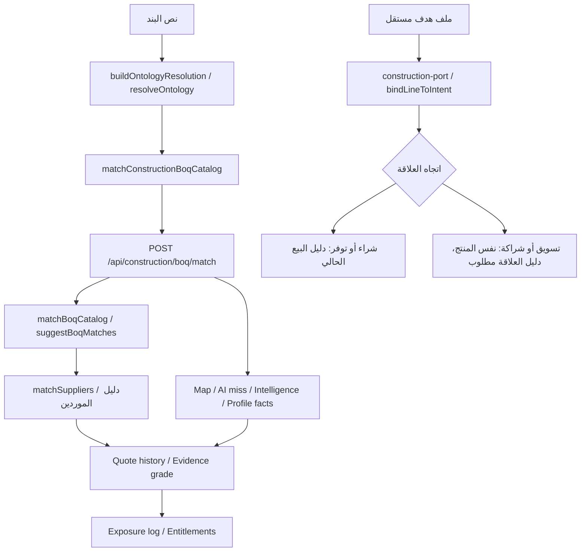

# خريطة الربط الفعلي وإعادة الاستخدام — المرحلة 0

تاريخ الفحص: 12 أكتوبر 2026. المصدران المقروءان: واجهة فرق بناء في `/Users/m4pro/farqconstraction/farqconstraction` والخادم في `/Users/m4pro/farq-pricing-api-proof/api`. حالة المصدر ليست نسخة إنتاج مؤكدة؛ لبعض ملفاته تعديلات سابقة غير محفوظة. لذلك سجلنا SHA-256 للملفات المستوردة في `construction-inspection.json` بدل الاعتماد على اسم الفرع وحده. لم نعدّل هذه المصادر.

متابعة: payload الواجهة المحلية cpo-v11، وpayload/resolver الخادم cpo-v27. الخريطة تصف ارتباطات الكود، ولا تثبت اقتران النسختين المحليتين أو توافقهما مع الإنتاج. تجربة التوسيع استخدمت resolver الخادم نفسه بدل بناء نسخة جديدة من مصدر الواجهة الأقدم؛ راجع `public-validation.md`.

## السلسلة الموجودة

المسار السفلي أداة اختبار معزولة فقط؛ لا توجد واجهة أهداف أو route جديدة أو اتصالات إنتاج موصولة بعد. لا تُفسّر أسهم الرسم على أنها دليل تشغيل flags في البيئة المنشورة.

| القدرة | الملفات والدوال الفعلية | API والربط | ما ثبت وحدود التعميم |
|---|---|---|---|
| CPO وفهم البند | واجهة `src/lib/procurementOntology.ts: resolveOntology / resolveOntologyBatch`؛ `src/lib/canonicalIntent.ts: buildOntologyResolution / forMatching` | `src/api/constructionClient.ts: matchConstructionBoqCatalog` يحمل resolution مع الصفوف إلى `/api/construction/boq/match` | المحرك موجود، والنسخة المجمعة للخادم تعمل محليًا؛ لا ننشئ قاموسًا ثانيًا |
| سلطة فهم الخادم | `lib/construction/line-intent-authority.js: serverResolver / bindLineToIntent`؛ `procurement-ontology-port.js`؛ `data/construction/procurement-ontology.resolver.cjs` و`.data.json` | إعادة فهم النص على الخادم؛ wire hint ليس مصدر الحقيقة | cpo-v27 مقترن محليًا؛ أدخلنا هذه الدالة نفسها في port الاختبار |
| BOQ والكتالوج | `supabase-repository.js: matchBoqCatalog` (2010)؛ `boq-catalog-matching.js: parseBoqMatchRows / suggestBoqMatches / extractPrintedSku` | POST `/api/construction/boq/match` | يقرأ items/الكتالوج ثم يستدعي `this.matchSuppliers` بمرشح item_ids وactor؛ BROWSE وGENERAL لا يثبتان التطابق |
| دليل الموردين والمطابقة | `supabase-repository.js: matchSuppliers` (2234)؛ `boq-directory-matching.js: attachBoqDirectoryMatching`؛ `supplier-discovery-runtime.js: attachSupplierDiscovery` | POST `/api/construction/suppliers/match`؛ الواجهة `matchConstructionSuppliers` | المسار الحالي يكتشف بائعين. لم نثبت وجود اكتشاف مشترين منه؛ النشاط أو الاسم وحدهما لا يكفيان |
| الخطة الموحدة | `supplier-match-v2/index.js: createSupplierPlanner / parseRows`؛ `supplier-match-v2/plan.js: buildPlan`؛ `supplier-plan-lane-runtime.js: attachSupplierPlanLane` | POST `/api/construction/boq/supplier-plan`؛ GET `/api/construction/rfqs/:id/supplier-plan` | مسار BOQ يسمح بخطة دون إنشاء RFQ. الدمج في قوائم المطابقة مشروط بـCONSTRUCTION_ONE_MATCHING_ENGINE وخدمة supplier_match_v2؛ taxonomy تجاري بنائي يحتاج تعميمًا |
| Map / Intent miss | `boq-match-map-suggestion-runtime.js: attachBoqMatchMapSuggestions`؛ `procurement-intent-ai-miss-runtime.js: attachProcurementIntentAiMiss` | طبقات داخل repository في `runtime.js` | map flags وAI flags تُشغّلها؛ غير المثبت تفعيله لا نعلنه موصولًا فعليًا بالإنتاج. لم نشغّل AI أو إثراء خارجي |
| Intelligence وحقائق المحادثات | `supplier-intelligence-runtime.js: attachSupplierIntelligence`؛ `supplier-profile-facts.js: attachSupplierProfileFacts`؛ `supplier-choice-learning.js: attachSupplierChoiceLearning` | wrappers في `runtime.js` | الأول default OFF؛ حقائق الملف مشروطة بـCONSTRUCTION_INBOX_AI_ENABLED. نحتفظ بوسائل التواصل والأدلة الحالية، ولا ننشئ Inbox بديلًا |
| درجات الأدلة | `supplier-evidence-grade.js: evidenceSources / gradeOf / gradeSupplier / attachEvidenceGrade`؛ repository `loadSupplierEvidence / itemIdsByNames` | مخرجات match/boq؛ إعادة ترتيب فقط مع CONSTRUCTION_EVIDENCE_GRADE_RANK=1 | استوردنا نفس gradeSupplier. الدرجة الإيجابية ليست إثبات مخزون أو نية شراء، وبعض مصادرها NAME/ACTIVITY/AI_WEBSITE؛ يجب إبقاء المصدر ومراجعة الدليل حسب الهدف |
| العروض السابقة | `supplier-quote-history.js: buildPriorQuoteIndex / rankWithPriorQuotes / applyToBoqResult / attachQuoteHistoryPriority` | GET `/api/construction/suppliers/:id/quote-history`؛ أولوية داخل المطابقة | read scoped للمشتري؛ اختبارات الترتيب والحفاظ على أعضاء خطة الموردين ناجحة. لا نعكس «عرض سابق كمورد» إلى «مشتري محتمل» |
| الكتالوج والأسعار | repository يقرأ `catalog_products / catalog_product_offers`؛ `supplier-price-memory.js: buildObservation / eligible`؛ `supplier-price-memory-store.js` | GET `/api/construction/catalog`؛ GET `/api/construction/rfqs/:id/price-memory` | أهلية السعر تشمل المنتج والوحدة والكمية والضريبة والتوصيل والصلاحية. استوردنا eligible الأصلي واختبرنا اختبارات SQL المحلية الأصلية |
| البدائل | `equivalents.js: equivalentsForLines / evaluateLine / resolveItemByText`؛ `web-discovery/*` | GET `/api/construction/rfqs/:id/equivalents`؛ GET `/api/construction/rfqs/:id/lines/:lineId/equivalents` | موجودة ومشروطة بخدمة equivalents؛ بقيت مرتبطة بـRFQ في API. تعميم الواجهة إلى Goal يحتاج adapter لاحقًا؛ هذه القدرة فُحصت في الكود ولم تُختبر وظيفيًا في هذه الدفعة |

## الربط الذي لا يزال غير موجود

`/Users/m4pro/farq-targeting/server.py: ai_parse / fallback_parse / search` و`trial_search.py: PROFILES / interpret / extend_intent / Directory.search` يملكان فهمًا وقوائم منتجات خاصة بالبحث؛ لم نجد استدعاء CPO أو محرك construction فيهما. هذا هو الانفصال الحالي الذي ينبغي إصلاحه باستخدام port مشترك، لا بإنشاء matching جديد. لم نعدّل الخدمة المنشورة.

## نتائج عينات المحرك المشترك

| النص | النتيجة الأصلية | قرار المرحلة 0 |
|---|---|---|
| أبواب PVC | CANONICAL pvc_door | نفس المنتج عبر شراء/تسويق/توفر/شراكة؛ يتغير اتجاه العلاقة فقط |
| كيبل 4×16 مم | FAMILY_ONLY power_cables | فهم على مستوى العائلة؛ لا حسم للمواصفات أو المخزون |
| قهوة / أكواب ورقية / مستلزمات طبية | UNRESOLVED | فجوة تغطية في CPO، بلا بديل مخترع |
| مواد نظافة | industrial_cleaner | تعميم ضيق يحتمل فقدان أنواع احتياج العميل؛ يحتاج اختبارًا ذهبيًا ومراجعة قبل الاستخدام |
| صيانة مصاعد | passenger_elevator | منتج مصعد لا يثبت مقدم خدمة صيانة؛ طبقة الهدف تمنع قبول دليل البائع كدليل خدمة |

## ما لا يجوز تشغيله تحت وصف «قراءة فقط»

`runtime.js` يضيف `supplier-exposure-log.js: attachExposureLog` وقد يكتب سجلات عرض حتى لطلبات المطابقة. كذلك POST `/rfqs/:id/price-memory/materialize` يكتب، وPOST `/rfqs/:id/equivalents/web` يكتشف خارجيًا. لذلك أداة المرحلة 0 تستورد الدوال الموجودة مباشرة ولا تنشئ runtime ولا تستدعي هذه endpoints. اختبارات الأصل تستخدم PGlite/مستودعات وهمية وخادم loopback؛ أضفنا حاجز TCP/fetch ومنع مفاتيح الاتصال المعروفة.

## إثبات إعادة الاستخدام

`services/goal-foundation/construction-port.cjs` يستورد الملفات الأصلية من root صريح؛ لا ينسخ Ontology أو ranker. الاختبارات تقارن نتيجة bindLineToIntent الأصلية، وهوية دوال history/memory، ونتائج المطابقة والدرجة الأصلية، وتفحص ثبات بصمات ملفات المصدر. القواعد الجديدة عقود هدف واتجاه وحدود صلاحية الدليل فقط؛ بيانات الجهات الوهمية لا تُستخدم كدليل تغطية حقيقية.
