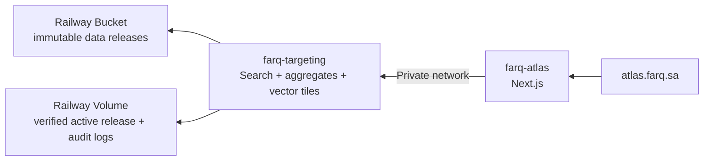

# تشغيل فرق أطلس داخل مشروع Railway واحد

## النتيجة المطلوبة

كل مسار حي في أطلس يمر داخل مشروع Railway `111208f2-1492-4e9c-88a1-459f0d348fc8`:

لا تعتمد الحاوية على ملفات جهاز مطور، ولا على نطاق خدمة استهداف في مشروع
Railway آخر. لا تُنقل بيانات جهات الاتصال إلى الواجهة من أجل تشغيل الخريطة.

## ما فُحص في الوضع الحالي

- المشروع يحتوي خدمة واحدة باسم `FARQ-B2B`، ونشرها ناجح من فرع `master`.
- متغير `TARGETING_ORIGIN` فيها يشير حالياً إلى خدمة استهداف عامة في مشروع
  Railway آخر. لذلك المشروع ليس مكتفياً بذاته بعد.
- Dockerfile لخدمة الاستهداف كان يتطلب ملفات `data/` أثناء البناء، وهي
  مستثناة عمداً من Git. لهذا فشل البناء عند حذف الملفات المحلية.

## خطة النقل الآمنة

1. أنشئ Bucket داخل هذا المشروع، وVolume لخدمة `farq-targeting` فقط.
2. ارفع إصداراً معتمداً للبيانات إلى `releases/<release-id>/` مع
   `manifest.json` وSHA-256 لكل ملف. لا تستخدم بيانات تجريبية ولا مجلد جهاز.
3. أنشئ خدمة `farq-targeting` من مسار المستودع
   `services/targeting-api`، مع Root Directory لهذا المسار وHealthcheck
   `/healthz`. أضف متغيرات Bucket في الخدمة نفسها فقط.
4. أنشئ خدمة `farq-atlas` من `apps/atlas` وDockerfile الخاص بها. اضبط
   `TARGETING_ORIGIN` إلى اسم نطاق خدمة الاستهداف الخاص الذي تعرضه Railway
   داخل المشروع، مع متغير المصادقة الداخلي نفسه في الخدمتين.
5. أبقِ خدمة `FARQ-B2B` قائمة أثناء التحقق. إن كانت لازمة للواجهة القديمة،
   حدّث `TARGETING_ORIGIN` فيها إلى العنوان الخاص نفسه؛ لا تتركها تشير إلى
   مشروع خارجي. الكود يرفض الآن العمل بصمت مع عنوان افتراضي خارجي إذا غاب
   المتغير.
6. اختبر: `/healthz`، بحث المقاولات، اختيار حي، النقاط المتجهة، القائمة
   المقسّمة، وإحصاءات الحي، ثم كرر ذلك من الجوال. لا ترسل حملة أو طلباً خارجياً.
7. بعد نجاح القياس لمدة تشغيل متفق عليها والتأكد من عدم وجود مستهلك للخدمة
   القديمة، اطلب موافقة صريحة قبل حذف أي خدمة أو مشروع قديم.

## خطة التراجع

- عند فشل إصدار بيانات جديد: أعد `TARGETING_DATA_RELEASE` إلى prefix الإصدار
  السابق ثم أعد النشر. لا تُستبدل النسخة الحالية قبل اكتمال التحقق.
- عند خطأ في ربط أطلس: أعد `TARGETING_ORIGIN` إلى القيمة السابقة مؤقتاً، ثم
  عالج الخدمة الداخلية في بيئة المعاينة.
- لا حذف للـ Bucket أو Volume أو مشروع Railway القديم ضمن التراجع.

## دليل تشغيل مطلوب قبل التحويل النهائي

- سجل صحة `GET /healthz` من خدمة الاستهداف الجديدة.
- سجل يثبت أن manifest وملفاته اجتازت SHA-256، دون تسجيل أسماء مفاتيح أو أسرار.
- لقطات أو نتائج اختبار تؤكد أن عدد نتائج الحي والقائمة وطبقة النقاط تستخدم
  cohort واحداً بعد اختيار الحي.
