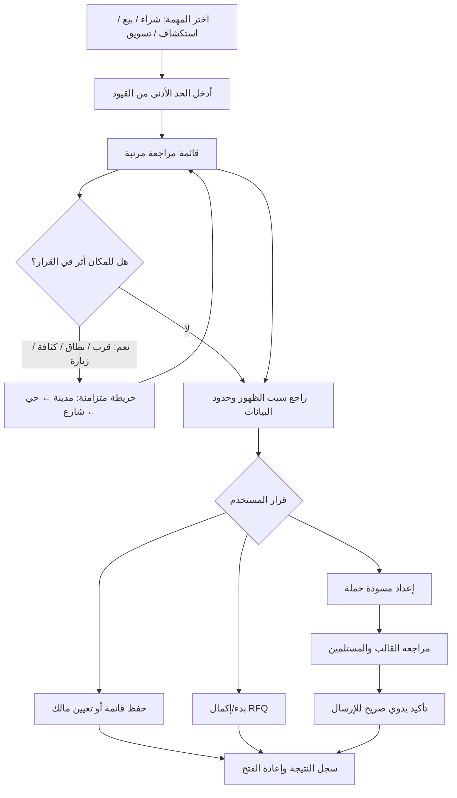
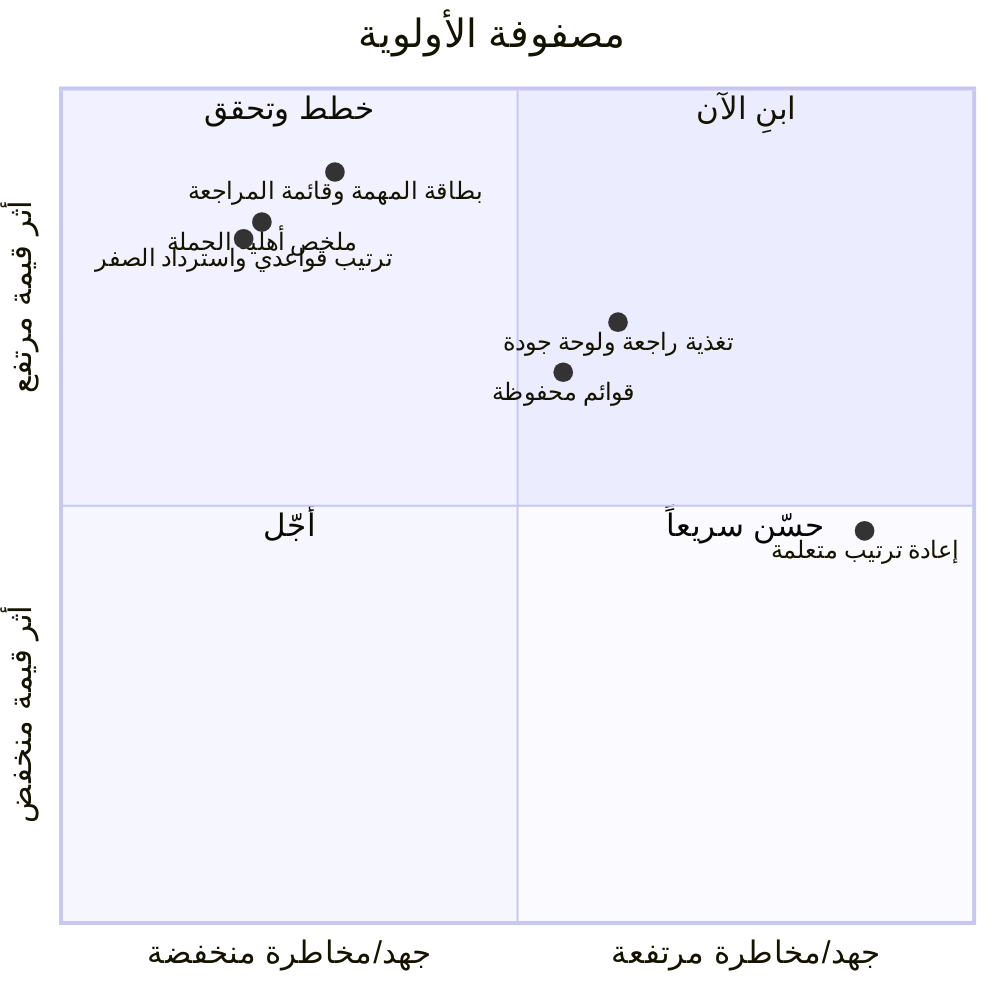

# حوّل الخريطة إلى قرار قابل للمراجعة

**الخلاصة التنفيذية.** ينبغي أن يعاد تصور «خريطة فرص فرق» كمساحة إنجاز مهمة تجارية تنتهي بقائمة مراجعة قابلة للتدقيق، لا كخريطة تُطلب من كل مستخدم التنقل فيها. **التوصية الاستراتيجية الوحيدة هي إطلاق «قائمة المراجعة الموجّهة بالمهمة» P0**: يبدأ المشتري أو البائع أو المستكشف أو مسوّق فرق بمهمة وقيود قليلة، ثم يحصل على قائمة مرتبة بأسباب وحدود بيانات واضحة، مع خريطة متزامنة تُستخدم فقط عندما يغير المكان القرار. هذا ينسجم مع نمط المنتجات الموثق: Google يربط قائمة النتائج بعلامات الخريطة، وSalesforce يستخدم الخريطة لتخطيط الزيارات مع قائمة للفرز والعمل الجماعي، ومنصات التوريد تنتقل من البحث إلى الملف ثم القائمة المختصرة وطلب العرض ([Google](https://developers.google.com/maps/architecture/places-ui-kit-getting-started)، [Salesforce](https://help.salesforce.com/s/articleView?id=000381386&language=en_US&type=1)، [Thomas](https://sourcing.thomasnet.com/)). وهو أيضاً أقل مخاطرة من بناء «مطابقة ذكية» جديدة قبل قياس صحة الدليل والنتيجة التجارية. لا توجد أدلة عامة تثبت أن مستخدم B2B السعودي يفضّل الخريطة على القائمة أو أن رقم واتساب ظاهر في الدليل يصلح للتسويق؛ لذلك يعامل التقرير هاتين النقطتين كفرضيتين للاختبار. يبقى الإرسال عبر واتساب يدوياً بعد مراجعة صريحة، ولا تصبح أهلية القناة أو ظهور رقم دليلاً على موافقة تسويقية.

## 1. السؤال والقرار المقترح

**قرار المنتج المقترح [استنتاج]:** لا تبنوا محرك توصية أو شاشة خريطة أكبر في الدورة القادمة. ابنوا «قائمة مراجعة» موحدة فوق النتائج الحالية، مع مدخل مهمة خاص بالدور، وترتيب قواعدي قابل للشرح، وحالة بيانات على كل صف، وإجراء تجاري صريح في النهاية. الخريطة تصبح لوحة سياق مكانية متزامنة وليست بوابة إلزامية: تفتح لتحديد حي أو شارع أو موقع مشروع، أو لفهم التغطية والتجمعات، أو لتخطيط زيارة. هذا القرار يزيل عبء التنقل عندما تكون المهمة مقارنة عدة جهات، ويحافظ على القيمة التي لا تقدمها القائمة حين يكون القرب أو النطاق الجغرافي جزءاً من القرار.

**لماذا الآن [دليل موثق]:** التدفق الحالي غني بالفعل: شراء بالبحث أو بالكراسة، بيع بمنتجات/كتالوج، استكشاف سوق، وطلب تسعير رسمي، مع مدينة وحي وشارع وفلاتر وملف منشأة وقائمة حملة ومسودات وطلبات. لكنه يبدأ في واجهة واحدة واسعة ويتيح إجراءات مختلفة قبل توحيد تعريف «المخرج المفيد» ([مرجع تدفق الإنتاج](/Users/m4pro/farq-pricing/docs/architecture/opportunity-map-flows-ar.md)). النتيجة المقترحة لا تلغي تلك المسارات؛ تجعل مخرجها المشترك واضحاً: مجموعة جهات لفحصها أو طلب عرض أو حفظها أو إعداد مسودة حملة.

## 2. ما تقوله الممارسات العالمية وما لا تقوله

**الدليل الموثق:** Salesforce Maps يعرض سجلات مرسومة في قائمة قابلة للفرز والتصفية والمقارنة، ويتيح اختيار مجموعة للعمليات الجماعية وحساب المسافة؛ وظيفته المعلنة هي مساعدة ممثلي الميدان في ترتيب الزيارات ([Salesforce Maps](https://help.salesforce.com/s/articleView?id=000381386&language=en_US&type=1)). Google Places UI Kit يعرض نتائج النص/المكان كقائمة وعلامات، ويقود اختيار أي منهما إلى تفاصيل المكان نفسها ([Google](https://developers.google.com/maps/architecture/places-ui-kit-getting-started)). Thomas يبدأ باكتشاف المورد عبر البحث والفلاتر ثم الملف، ويمكن حفظ البحث للعودة إلى التحقق والقائمة المختصرة وRFI ([Thomas saved searches](https://help.thomasnet.com/saved-searches)). أما Amazon Business فيجعل RFQ يحتوي بنوداً وشروطاً ثم يحتفظ بالعروض في مساحة إدارة دائمة ([Amazon Business RFQ](https://business.amazon.com/en/solutions/bulk-buying/request-for-quote)).

**الاستنتاج:** النمط القابل للنقل هو «اكتشف ← قيّم دليلاً منظماً ← أنشئ قائمة ← اتخذ إجراءً محفوظاً»، وليس نسخ checkout أو خوارزمية ترتيب أي منصة. ينبغي أن تعرض بطاقة المنشأة دليل الظهور، النشاط/التخصص، النطاق، اكتمال البيانات، والتحقق عندما يكون تعريفه ومصدره ظاهرين؛ لا «أفضل 92%». كما يجب فصل ثلاثة أشياء: بحث محفوظ لمراقبة سوق، قائمة مختصرة لمهمة محددة، وطلب عرض يمتلك حالته ومستلميه وردوده. لا تثبت هذه الأمثلة أن التصميم ذاته سيزيد تحويل فرق؛ إنها تبرر فرضية التصميم فقط.

## 3. الواقع السعودي يرفع معيار الثقة والامتثال

**الدليل الموثق:** في مسح GASTAT لعام 2023، أفادت 97.7% من المنشآت بتوافر الإنترنت و91.3% باستخدام الخدمات الحكومية الإلكترونية ([GASTAT](https://www.stats.gov.sa/documents/d/guest/ictbusiness-2023-en-1-pdf)). وتتعامل منصة اعتماد الحكومية مع اكتشاف المنافسات والتقييم والإرساء إلكترونياً، وتتيح قائمتها فلاتر النشاط والمنطقة ([HRSD/اعتماد](https://www.hrsd.gov.sa/ministry/about-ministry/competitions-and-purchases)، [قائمة اعتماد](https://monafasat.etimad.sa/tenders/index)). هذا يدعم واجهة رقمية عربية ومهيأة للجوال، لكنه لا يثبت أن الشراء الخاص يتم من خلال خريطة أو قناة واحدة. كما أن عنوان SPL الوطني يوفر مرجعاً مكانياً يمكن البحث فيه بالنص والإحداثيات والعنوان المختصر، لكنه لا يضمن صحة تصنيف منشأة أو حداثة هاتفها في دليل طرف ثالث ([SPL](https://splonline.com.sa/en/national-address-api/)).

**قيد ملزم [دليل موثق]:** سياسة WhatsApp تشترط أن يزوّد الشخص الرقم وأن يوافق صراحة على رسائل واتساب اللاحقة من النشاط، مع احترام الإيقاف والانسحاب؛ وتستلزم الرسائل التي يبدأها النشاط قالباً معتمداً ([Meta](https://business.whatsapp.com/policy/preview?lang=en_US)). ويحظر نظام حماية البيانات الشخصية استخدام وسائل الاتصال الشخصية للمواد التسويقية من دون موافقة وطريقة واضحة للإيقاف، ويشترط أن تكون الموافقة موثقة ومحددة الغرض ([SDAIA PDPL](https://dgp.sdaia.gov.sa/wps/portal/pdp/knowledgecenter/details/PDPL)، [اللائحة التنفيذية](https://sdaia.gov.sa/en/Research/Documents/ExecutiveRegulations.pdf)). **الاستنتاج التشغيلي:** افصلوا اكتشاف موقع منشأة عن إثراء جهة اتصال وعن جمهور حملة موافق عليه؛ لا تُحوّلوا رقم واتساب مكتشفاً إلى مستلم تسويقي لمجرد أنه صالح تقنياً. هذه ليست فتوى قانونية؛ يلزم اعتماد مالك الخصوصية والمستشار السعودي لمصادر فرق ودورها القانوني ومدة الاحتفاظ.

## 4. تشخيص التدفق الحالي: قوة حقيقية وفجوة واحدة

**خط الأساس الموثق:** عند الدخول، يختار المستخدم شراء أو بيع أو استكشاف أو طلباً رسمياً. يمكنه تضييق المدينة ثم الحي فالشارع، والبحث الحر، وفتح ملف منشأة، أو البدء في RFQ. في البيع، تبقى منتجات الكتالوج مسارات بحث قابلة للتبديل. وفي التسويق، يحلل المساعد شريحة ثم ينشئ مسودة من 1 إلى 300 جهة ولا يرسل رسالة ([مرجع التدفق](/Users/m4pro/farq-pricing/docs/architecture/opportunity-map-flows-ar.md)). عند فشل التحديث تبقى النتائج السابقة معلّمة بأنها تخص نطاقاً سابقاً وتعطّل الإضافة والإرسال؛ هذه حماية جيدة يجب الحفاظ عليها.

**الفجوة [استنتاج]:** المسارات تقدم «نتائج وخريطة وإجراءات» أكثر من تقديمها «قراراً تالياً». المستخدم الذي يبحث عن مورد لا يرى فوراً ما الذي يجعله مؤهلاً أو يحتاج تحققاً أو مستبعداً بسبب شرطه؛ والمستكشف قد يقرأ كثافة دليل كأنها فرصة تجارية. لا تحتاج فرق إلى تغيير بنية البحث أو الـRFQ كي تعالج ذلك: تحتاج سطح عمل يجعل قائمة المراجعة هي العقدة المشتركة، ويجعل خريطة الأحياء والشوارع أداة تفسير مكانية مشروطة بالسياق.

## 5. التصميم المستقبلي: تدفق واحد وأربع عدسات

**التدفق المقترح [استنتاج]:** يختار المستخدم مهمة، يدخل أقل قيود ضرورية، ويراجع قائمة مرتبة قابلة للتفسير، ثم يحفظها أو ينفذ إجراءً مناسباً. «الخريطة» تظهر بجانب القائمة على سطح المكتب ويمكن طيّها؛ وعلى الهاتف لا تسبق أول ثلاث نتائج، بل تفتح عبر «عرض المكان/تحديد النطاق». يظل الربط ثنائي الاتجاه: تحديد دبوس يبرز الصف، وتحديد الصف يبرز الدبوس ويفتح ملفاً واحداً. الدور يغير تعريف المخرج، لا قاعدة النزاهة: المشتري ينشئ قائمة مورّدين لبند؛ البائع قائمة مشترين لمنتج؛ المستكشف ملخص نطاق كبداية بحث؛ ومسوق فرق مسودة حملة قابلة للتدقيق.

**مواصفات الشاشة P0 [استنتاج مبني على الخط الأساس]:** أعلى الصفحة بطاقة مهمة واحدة وزر أساسي واحد: «أضف بنداً + مدينة»، أو «اختر منتجاً»، أو «اختر نشاطاً أو حياً»، أو «اكتب الشريحة والغاية». تحتها شرائح قيود قابلة للحذف، ثم تبديل ترتيب واضح: «الأقرب لطلبك» افتراضياً، «الأقرب للموقع» فقط إن كان الموقع دقيقاً، و«أكمل بيانات أولاً». كل صف يعرض سبب ظهور واحداً وحالة بيانات واحدة، مع تفصيل فيه 2–3 أسباب مثل تطابق نشاط/تخصص أو ضمن الحي، وتحذير مثل موقع غير دقيق أو حالة تشغيل غير مؤكدة. لا يجوز أن يزيل نقص البيانات الصف بصمت؛ يصنفه «يحتاج تحقق» أو يشرح عدم أهليته لإجراء محدد. في الصفر، يقترح توسيع الشارع إلى الحي أو الحي إلى المدينة أو تبديل الجملة أو تخصصاً قريباً، ولا يطبق الاقتراح تلقائياً.

## 6. دلالات البيانات: بحث وترشيح وترتيب لا «ذكاء» مبهم

**قرار لغوي وتقني [استنتاج]:** البحث يستدعي المرشحين وفق النص والنطاق؛ الترشيح يطبق شروط المستخدم؛ الترتيب ينظم ما بقي بقواعد معلنة؛ المطابقة تقدير توافق مع *مهمة محددة*؛ والتوصية اقتراح قابل للتجاهل. لا تسموا P0 «AI matching»، ولا تسموا ترتيباً «الأفضل». تسمية صادقة هي «ترتيب مناسب لطلبك»، مع رابط «لماذا؟» وسجل داخلي لإصدار القاعدة وسبب العضوية.

**قاعدة P0:** رتّب فقط داخل النتائج المؤهلة: تطابق النشاط/التخصص أولاً، ثم غياب حالة إغلاق معروفة، ثم شرط النطاق المكاني، ثم كاسرات التعادل المعلنة مثل اكتمال البيانات وموثوقية الحي ووجود موقع دقيق وتعدد المصادر. لا يدخل وجود واتساب ولا الشعبية كبرهان على الملاءمة أو الموافقة. تتسق الحاجة إلى تفسير ذي معنى وحدود معرفة مع مبادئ NIST التي تطلب سبباً ودقة وحدوداً للسياق الذي يعمل فيه النظام ([NISTIR 8312](https://nvlpubs.nist.gov/nistpubs/ir/2021/NIST.IR.8312.pdf)). **فرضية اختبار:** إظهار السبب والحدود يزيد تكوين قوائم المراجعة أو حكم المستخدم على الصلة من دون زيادة الزمن أو الصفر؛ لا يدّعي التقرير أنها نتيجة محققة.

## 7. القوالب وواتساب: السلوك الحالي وحدود التوسع

**الواقع الموثق:** تعرض قائمة الحملة القوالب المعتمدة والمهيأة للإرسال فقط؛ يظل القالب قيد المراجعة خارج قائمة الاختيار إلى أن تعتمدْه Meta. عند اختيار تصنيف رئيسي يقترح المنتج قالباً تسويقياً خاصاً به إن كان معتمداً، وإلا يعود إلى قالب التعريف العام. لا يحدث اتصال خارجي عند حفظ المسودة؛ يراجع المستخدم الجهات والقالب ثم يؤكد الإرسال صراحة في خطوة منفصلة ([مرجع التدفق](/Users/m4pro/farq-pricing/docs/architecture/opportunity-map-flows-ar.md)).

**سلوك المتغيرات الأحدث [دليل من التنفيذ]:** القالب القياسي ثنائي المتغير يملأ `{{1}}` باسم المنشأة المستلمة و`{{2}}` بنص/سياق الحملة القابل للتعديل. القوالب التي تحتوي متغيرات جسم إضافية متصلة يمكن إرسالها بعد أن يدخل مالك الحملة قيمها وتظهر في المعاينة بالترتيب الرقمي؛ لا تُجدول حتى تدعم خدمة الجدولة حفظ تلك القيم. المتغيرات في الرأس أو الزر، أو رأس وسائط، لا تلائم مسار الإرسال الحالي لأنه لا يرسل قيمها ([منطق متغيرات القالب](/Users/m4pro/farq-pricing/src/api/targetingClient.ts)، [درج الحملة](/Users/m4pro/farq-pricing/src/pages/targeting/map/CampaignTray.tsx)). **قرار P0:** لا تغيروا هذا الفصل. أضيفوا إلى ملخص الدفعة مصدر الموافقة وحالة الانسحاب وأسباب الحجب، واجعلوا «إعداد اتصال» إجراء مراجعة لا إرسالاً تلقائياً.

## 8. الأولويات والتنفيذ

| المبادرة | أثر القيمة | الجهد/المخاطرة | الأولوية | قرار التنفيذ |
|---|---:|---:|---:|---|
| بطاقة المهمة + قائمة مراجعة + سبب وحالة بيانات | مرتفع | منخفض إلى متوسط | P0 | تبنى فوق البحث والملف الحاليين |
| ترتيب قواعدي وبدائل صفر نتيجة | مرتفع | منخفض | P0 | قواعد قابلة للتدقيق، بلا نموذج |
| ملخص أهلية الحملة قبل الحفظ | مرتفع للامتثال | منخفض | P0 | لا يغير التأكيد اليدوي |
| قوائم محفوظة تعاد تشغيلها | متوسط | متوسط | P1 | تحفظ المهمة والفلاتر وإصدار الترتيب، لا الأرقام في العميل |
| قيود اختيارية: كمية وموعد ونطاق خدمة وموقع مشروع | متوسط | متوسط | P1 | إدخال صريح، لا استنتاج من النص |
| تغذية راجعة صريحة ولوحة جودة الدليل | مرتفع للتعلم | متوسط | P1 | تحفظ على مستوى المهمة/القائمة |
| إعادة ترتيب متعلمة وتوصيات متابعة | غير مثبت بعد | مرتفع | P2 | shadow ranking بعد تسميات وتدقيق فقط |

**خطة التنفيذ:** في P0 يعاد تركيب صفحة النتائج فقط: مكوّن `TaskEntry` للمدخل، `ReviewList` للتصنيف والسبب، و`MapContext` للخريطة المتزامنة، مع استخدام RFQ وCampaign Tray وطلبات المستخدم كما هي. يضاف إلى كل قائمة سجل داخلي: المهمة والقيود ونسخة الترتيب ووقت الإنشاء ومصدر/عمر البيانات المجمع وسبب كل عضو وأهلية الإجراء. في P1 تضاف إعادة الفتح والفروق في الأهلية والجودة وتغذية راجعة مثل «النشاط غير مناسب» و«خارج النطاق». لا يبدأ P2 قبل وجود أحكام بشرية ونتائج عمل منظمة؛ وإلا سيتعلم النموذج من النقر أو الإرسال، وهما إشارتان غير موثوقتين للصلة.

## 9. القياس والتحقق قبل ادعاء القيمة

**الدليل الموثق:** لا تكفي النقرات لقياس رضا البحث؛ قد يحصل المستخدم على قيمة من قائمة النتائج بلا نقرة، ويتأثر الانتباه بموضع العنصر وبنية الصفحة ([Google Research](https://research.google/pubs/incorporating-clicks-attention-and-satisfaction-into-a-search-engine-result-page-evaluation-model/)). إطار HEART مفيد لربط هدف المنتج بمقاييس تجربة، لا لتوليد هدف رقمي عام ([Google HEART](https://research.google/pubs/measuring-the-user-experience-on-a-large-scale-user-centered-metrics-for-web-applications/)). لا توجد في مواد البحث خطوط أساس موثوقة لفرق، لذلك لا توضع نسب تحويل أو زمن مستهدف الآن.

**خطة القياس [استنتاج]:** مع موافقة التحليلات فقط، سجّل أحداثاً بلا نص بحث أو أسماء أو هواتف: `task_started`، `task_constraints_set`، `result_set_rendered` مع حزم العدد والجودة وإصدار الترتيب، `result_reason_expanded`، `review_list_created|saved|reopened`، `task_first_value`، واسترجاع الصفر وتحذير البيانات والإجراء `started|completed|blocked`. عرّف التفعيل لكل دور كمخرج قابل لإعادة الاستخدام: قائمة موردين محفوظة أو RFQ بدأ للمشتري، قائمة مشترين أو مسودة حملة للبائع، نطاق/نشاط محفوظ للمستكشف، ومسودة حملة مكتملة المراجعة للمسوّق. افصل دائماً `campaign_draft` عن `campaign_send`.

ابدأ بـ5–8 اختبارات مهمة مراقبة لكل دور على بيانات مصرح بها لمعرفة الالتباس اللغوي والثقة، ثم أطلق P0 مقاساً واجمع أسبوعين كاملين قبل قراءة الاتجاه. بعد ذلك راجع عينة طبقية من 30–50 قائمة لكل مهمة وحجم نتيجة، بحكمين مستقلين ومعيار معلن للنشاط والنطاق والدور وحالة البيانات. التجربة الأولى تقارن تغييراً واحداً فقط، مثل إظهار سبب الترتيب، ويكون مقياسها الأساسي أول قيمة أو حكم الصلة، مع حراس الصفر والزمن والتحذيرات والحجب. هذه خطة اختبار، لا ضمان لأثر سببي.

## 10. قرارات البوابة والمخاطر التي لا تُؤجل

**قرارات مطلوبة قبل P0:** اعتماد تعريف «قائمة المراجعة» ومخرج كل دور من مالك الأعمال؛ اعتماد قاموس سبب/حدود البيانات من مالك الدليل؛ تحديد مصادر الموقع وحق إعادة استخدامها وتاريخها؛ وإقرار مسار امتثال منفصل لجمهور التسويق يثبت مصدر الموافقة ونصها وإصدارها وغرضها ووقت الانسحاب. يحتاج فريق المنتج أيضاً قراراً صريحاً: الخريطة **مشروطة** بالسؤال المكاني وليست إلزامية لبدء كل مهمة. هذا هو الاختيار الذي يجعل التصميم قابلاً للاختبار بدلاً من افتراض أن التصفح الجغرافي قيمة بذاته.

**المخاطر والحواجز:** أخطر المخاطر سجلات مكررة أو قديمة، خلط فرع بالمقر، انحياز الترتيب لجهات أكمل بيانات، قراءة الكثافة كفرصة، وخلط رقم واتساب مع موافقة. الحواجز هي مصدر وتاريخ وثقة لكل موقع، آلية تصحيح/مطالبة للبائع، تحذير ظاهر للحالة غير المؤكدة، عدم استخدام القناة في ترتيب الملاءمة، وقائمة كبت مركزية للانسحاب. أوقفوا أي تجربة ترتيب عند تدهور موثق في الصلة أو التحذيرات أو الشكاوى، وارجعوا إلى القاعدة القابلة للتفسير. **النتيجة:** فرق لا تحتاج أن تثبت أن لديها خريطة أذكى؛ تحتاج أن تثبت، بالتدريج، أن المستخدم يصل إلى قرار يمكنه تفسيره ومراجعته والتصرف عليه بأمان.
